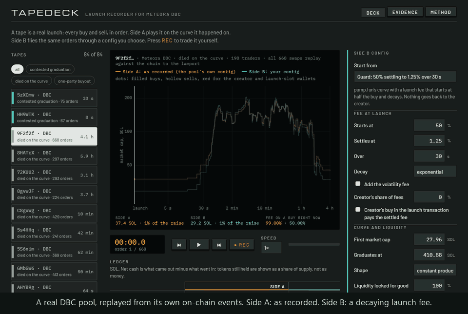

# Tapedeck

[](https://github.com/essej72/tapedeck/actions/workflows/test.yml)

Play back any Meteora DBC launch. Fly it again under a different config. Or take the stick and trade it yourself. On an engine that is checked against the chain.

A **tape** is a real launch, order by order: who bought, who sold, when, how much. The deck plays it on two sides.

- **Side A** plays the launch on the curve it happened on.
- **Side B** flies the same orders through any config: one you design (through the SDK's own curve builders) or any config on mainnet, loaded by address. Every buyer spends the same amount at the same moment, every seller sells the same share of what they hold by then. A ledger shows who paid and who collected under each.
- **Any pool.** Paste a DBC pool address and the deck fetches its transactions in your browser, replays every swap against the events the program emitted, tells you whether they match, and puts the pool on the deck with its own config as Side A.
- **REC** hands you a paper wallet. Your orders go onto the tape at the moment you press, and the rest of the launch trades against the price you left behind.
- A config you like leaves as a file for Meteora's [Invent CLI](https://github.com/MeteoraAg/meteora-invent), or goes **straight to mainnet**: the deck asks the live program whether it takes the design (a simulation, no wallet needed), then creates the config from your own wallet.

Entry for the Meteora track, "Best use of Meteora's Dynamic Bonding Curve", Crypto World's Fair 2026.

**[Open the deck](https://essej72.github.io/tapedeck/)** · **[Pitch](https://essej72.github.io/tapedeck/pitch.html)** · **[Evidence](https://essej72.github.io/tapedeck/#evidence)**



## What it found

<!-- figures:start -->
- **Census:** 1,768,464 pools under 543,738 configs, read from program accounts on 2026-10-10.
- **Where faking a graduation costs under 2% of the raise:** 84% of 1,131,326 pools completed their curve.
- **Where it costs 10% or more:** 2.7% of 438,317 pools did.
- **pump.fun, recorded 2026-10-10 to 2026-10-11:** 78 of 121 graduations that passed the check were one party buying the curve in the launch slot.
- **Engine against chain:** 116,724 real swaps replayed across 355 pools and 50 kinds of config, 0 mismatches.
- **Engine against the program itself:** 3,384 swaps simulated against the live program on 262 open pools, 2,601 of them exact-out (a swap nobody makes on mainnet, so no history can check it), 0 disagreements.
- **Shelf:** 84 tapes: 24 DBC pools read from the chain and 60 pump.fun launches, picked from 561 that passed the fit check. Of 1,206 pump.fun launches recorded, 584 had under 12 orders and 61 failed the check.
<!-- figures:end -->


The cheapest way onto every "just migrated" feed is for a creator to buy their own curve in the launch transaction. Whether that is expensive or free is decided by the config: the fee at second zero, who the fee goes back to, who owns the liquidity after migration. `src/engine/buyout.ts` prices that round trip for any config. `src/census/` reads every config and pool on mainnet and puts the two side by side. The split is not subtle: where faking is nearly free, nearly everything "graduates".

## Why believe the engine

Prices and fees come from the quote functions of `@meteora-ag/dynamic-bonding-curve-sdk`. Around them, `src/engine/pool.ts` does what the on-chain program does and the SDK leaves to it (`process_swap.rs`, `virtual_pool.rs`, `fee.rs`): refresh the volatility tracker before the quote, apply the result to reserves and fee buckets, split the trading fee between partner and creator, update the tracker after, honour the minimum-fee first swap, complete the curve at the threshold.

Then it is held to the chain:

- `node src/validate.ts <pool>` fetches a pool's whole history, replays every swap from the pool's own events and compares each field of each result with what the program emitted, to the lamport, then the final state with the live account.
- `node src/conformance.ts pick && node src/conformance.ts run` does that for pools spread over every combination of fee mode, fee token, activation type, first-swap setting and quote token in use on mainnet.
- A pump.fun tape goes on the shelf only if a DBC config equal to pump.fun's curve returns the recorded number of tokens on every curve buy.
- The deck does the same check live, in the browser, for any pool you paste. The browser build reads accounts and events from the IDL alone (no Anchor); it is tested against the SDK's Anchor coder on 160 real config accounts and 470 real events.
- `node src/dryrun.ts` builds the `create_config` transaction for the deck's built-in designs and for 150 random settings of its form, and has a node simulate each against the live program. 126 were accepted, and every one was stored field for field as the deck derives it (start price, migration price and base threshold included); the other 27 the SDK's own validation had already refused (under 10% of liquidity locked), which the deck shows as an error. The program refused none.
- `node src/probe.ts run` asks the live program about swaps nobody has made (exact-out), by simulation, and compares its answers with the engine's. See below.
- `npm test` runs the same checks offline on frozen mainnet data: pool histories of different config kinds, 160 real config accounts, 470 events, three pump.fun tapes, a spread of the simulated swaps, and 24 designs with the account the program stored for each.

## Check an SDK build against mainnet

The verified histories ship as one file, [`corpus.jsonl.gz`](https://github.com/essej72/tapedeck/releases/latest) (355 pools, 116,724 swaps, 50 kinds of config, events only, 20 MB). Any build of the SDK's swap math can be replayed through it, offline, in about a second:

```bash
node scripts/bundle-sdk-math.mjs ../dynamic-bonding-curve-sdk/packages/dynamic-bonding-curve
node src/conformance.ts rerun --corpus corpus.jsonl.gz --math data/sdk-math.mjs
```

Run on 11 October 2026:

| Math | Swaps replayed | Mismatches |
|---|---|---|
| SDK 1.5.13 (npm) | 116,724 | 0 |
| SDK 2.0 branch: [PR #123](https://github.com/MeteoraAg/dynamic-bonding-curve-sdk/pull/123) at `bdfe680`, #125 at `706bd11`, #126 at `ffde81d` | 116,724 each | 0 |
| The 2.0 math with one lamport added to every exact-in output (a check that the check works) | stops early | flagged in 327 of 355 pools |

What the corpus covers: 54,496 buys and 62,228 sells; 108,351 exact-in swaps and 8,373 partial fills (10 of them cut short at the migration price); 2,880 swaps with a referral; 220 swaps inside the pool-creation transaction; 81 curve completions; rate limiters, linear and exponential schedulers, the dynamic fee, fees in quote and in the output token, slot and timestamp activation. What it does not cover: exact-out swaps, which nobody makes (next section), and transfer-fee or transfer-hook tokens.

### Swaps nobody has made

Exact-out swaps are in the program and in the SDK, but there are none in those histories and none among 6,376 swaps in a sample of the program's most recent transactions (11 October, `src/hunt.ts`). History cannot check a swap nobody makes, so `src/probe.ts` asks the program itself. It builds the swap for a real open pool and has a public RPC node simulate it against the live program (`simulateTransaction` with signature checks off: nothing is signed, nothing is sent, there is no key). The trader in the simulation is a large exchange wallet standing in as payer, which any funded address can when signatures are not checked; nothing touches it. The program's own `EvtSwap2`, the pool account it leaves behind and the two vault balances are then compared with what the engine predicts from the pool account before.

Run on 11 October 2026, 262 open pools quoted in SOL, 48 kinds of config, half of them pools nobody had traded yet:

| Math | Simulated transactions | Swaps the program answered | Refusals | Disagreements |
|---|---|---|---|---|
| SDK 1.5.13 (npm) | 2,345 | 3,384, of them 2,601 exact-out | 265 | 0 |
| SDK 2.0 branch at `bdfe680`, `706bd11` and `ffde81d` | the same 2,345 | the same | the same | 0 at each |
| An exact-out quote one lamport too high (a check that the check works) | 1,558 with an exact-out swap | | | flagged in 1,558 |

Each pool is asked nine things: a control (an exact-in buy and sell, which history already proves, so a mismatch there would be the harness); exact-out buys of 0.2%, 15%, 60% and 85% of what is left on the curve, each followed by an exact-out sell, half of them with a referral (1,042 swaps); one token unit; one lamport; the last token on the curve; and one token more than the curve holds.

- **Every field agrees**: amount in, amount out, next price, trading, protocol and referral fee, and afterwards the pool account itself: reserves, every fee bucket, the volatility tracker.
- **Refusals agree.** One token past the end of the curve is `InsufficientLiquidity` or `AmountLeftIsNotZero` in the program and an error in the SDK. Buying exactly what is left completes the curve in 247 pools; in the 6 where the program refuses it, the SDK refuses it too.
- **The books match the vaults.** In all 2,080 transactions the program accepted, each vault's balance moved by exactly the change in the pool's reserve plus its fee buckets.
- **Dust rounds toward the pool.** No swap was free of fee. One lamport buys nothing in 201 of 261 pools and is kept as fee.
- **Fee schedules mid-run.** An old pool's schedule has run out, so 90 of the transactions went to 10 pools whose linear schedule was still running. No pool with a live rate limiter or an exponential schedule mid-run was found to ask.

The simulations are saved as [`probes.jsonl.gz`](https://github.com/essej72/tapedeck/releases/latest) and check offline against any build of the SDK:

```bash
node src/probe.ts check --file probes.jsonl.gz --math data/sdk-math.mjs
```

Limits: pools quoted in SOL only, no transfer-fee or transfer-hook tokens, and a simulation is one node's run of the program at one slot, not a landed transaction.

## From the deck to mainnet

Under Side B's settings, "Put this config on mainnet" has two steps.

1. **Ask the program.** The deck builds the SDK's `createConfig` transaction for the design on Side B and has a public RPC node simulate it against the live program with signature checks off. It reports whether the program accepts it, the rent, and whether the account it would store equals the config Side B has been flying. No wallet, nothing signed, nothing sent.
2. **Create it with your wallet** (Phantom, Solflare or Backpack). Your wallet is the payer, the fee claimer and the leftover receiver. The deck rehearses the transaction with your wallet as payer first, then hands it to the wallet to approve: one account, about 0.006 SOL of rent. Once the network confirms, the new config is read back from the chain and loaded onto Side B like any other mainnet config.

The page never holds a wallet key. The only key it makes is the new account's own, which has to co-sign its creation and is discarded. Step 1 and the rehearsal are what `src/dryrun.ts` runs in bulk; step 2 has been exercised up to the wallet's approval prompt with a stand-in wallet (the transaction that reaches the wallet carries a live blockhash and the new account's signature), and a declined prompt sends nothing.

## Run it

Node 24 or newer. No API keys, no build step for the scripts (Node runs the TypeScript directly).

```bash
npm install
npm test
npm run build
npm run serve
```

The site is static (`docs/`). It works from GitHub Pages or any file host.

## Rebuild the data

Everything comes from public sources: the public mainnet RPC, a second keyless RPC for transaction history, and pump.fun's public trade feed. All reads, nothing signed, nothing sent. (The one thing in the project that can send a transaction is the deck's "create it with my wallet" step, and only the visitor's wallet can sign it.)

```bash
node src/census/pull.ts pools       # every VirtualPool account (about 15 minutes, paced)
node src/census/pull.ts configs     # every PoolConfig account (about an hour)
node src/census/designs.ts          # designs, outcomes, cost of faking a graduation
node src/census/export.ts           # the trimmed file the site ships

node src/conformance.ts pick        # pools of every kind of config
node src/conformance.ts busy 250    # plus the busiest pools of the last day
node src/conformance.ts run
node src/conformance.ts report

node src/flows/dbc.ts pick 40       # recent busy DBC pools for the shelf
node src/flows/dbc.ts fetch
node src/flows/pumpfun.ts enqueue-listing 10
node src/flows/pumpfun.ts run       # pump.fun tapes, about 18 requests a minute
node src/flows/library.ts           # check, classify and pack the shelf
npm run build
```

## Where things are

| Path | What it is |
|---|---|
| `src/engine/pool.ts` | One virtual pool, advanced swap by swap the way the program does it, on the SDK's math |
| `src/engine/replay.ts` | A session: fly a tape through a config, on the curve and then in the migrated pool; take orders that are not on the tape |
| `src/engine/buyout.ts` | The cost of faking a graduation under a config |
| `src/engine/design.ts`, `presets.ts` | A design as SDK builder input, as stored config, and as an Invent CLI file; the deck's own designs |
| `src/deploy.ts`, `src/dryrun.ts` | The `create_config` transaction for a design, a dry run against the live program, and the comparison of what it would store |
| `src/engine/bytes.ts`, `src/events.ts`, `src/layout.ts` | Accounts and events read from the IDL alone, for the browser |
| `src/engine/verify.ts` | Replay a pool's history against its own events and report every difference |
| `src/engine/amm.ts` | The migrated pool: exact migration amounts, constant-product trading |
| `src/census/` | The whole-chain census and the design table |
| `src/flows/history.ts`, `chain.ts`, `chaintape.ts`, `dbc.ts` | Pool histories from the chain, verified and turned into tapes |
| `src/flows/pumpfun.ts`, `tapes.ts`, `pack.ts`, `library.ts` | pump.fun tapes: collect, turn trades into orders, check, pack |
| `src/validate.ts`, `src/conformance.ts`, `src/probe.ts` | Engine against chain: one pool, every kind of config, and swaps nobody has made (by simulation) |
| `web/` | The deck, the evidence page, the pitch page |
| `test/` | Offline tests on frozen mainnet data |

## How it uses Meteora

- **SDK math** for every curve trade: `getSwapResultFromExactInput`, `getSwapResultFromPartialInput`, `getSwapResultFromExactOutput`, `getFeeMode`, `getBaseFeeHandler`.
- **SDK builders and validators** for every designed config: `buildCurve`, `buildCurveWithMarketCap`, `buildCurveWithLiquidityWeights`, `getMigrationThresholdPrice`, `getMigrationBaseToken`. A config that plays on Side B is one `create_config` would accept.
- **The IDL** shipped with the SDK for account layouts and event decoding. Offsets are derived, not typed in.
- **Program accounts** read directly: every `PoolConfig` and `VirtualPool` on mainnet.
- **Program events** (`EvtInitializePool`, `EvtSwap2`, `EvtCurveComplete`) as the ground truth for replays.
- **Invent CLI** as one way out: Side B exports a `dbc_config` file, dry run on.
- **`createConfig`** as the other: the SDK's own transaction, simulated against the program and then signed by the visitor's wallet.
- **`swap2`** in simulation, to get the program's own answer for swaps no history contains.

## Limits

- A replay is a stress test, not a forecast. It prices the play on the tape under another config; it does not predict how traders would adapt. Under a 50% launch fee nobody sane buys in the launch slot. REC is the honest way to see how a launch trades differently.
- After migration the pool is modelled as full-range constant product with the config's flat fee. DAMM v2's own fee scheduler and dynamic fee after migration are not applied.
- The trade feed shows trades, not transfers. A wallet that sells tokens it never bought on the tape is merged with the wallet that most plausibly gave them to it. Bundles come out as one trader; an unrelated pair is occasionally merged by mistake.
- Completion rates by design are confounded by who uses each design. The claim is narrow: where faking is nearly free, nearly everything completes, and that is not demand.
- The tapes cover days, not seasons. Paper trading has no latency, failed transactions or priority fees.

## Found on the way

<!-- found:start -->
- **How far a known SDK bug reaches.** In SDK 1.5.13, `StateService.getPoolConfigsByOwner(owner)` filters `PoolConfig` accounts at byte offset 72, which is `leftover_receiver`; `fee_claimer` is at offset 40. I ran into it while indexing; the SDK team had opened a fix the same day ([PR #124](https://github.com/MeteoraAg/dynamic-bonding-curve-sdk/pull/124)). What the census adds is the size of it: on 2026-10-10, 200,278 of 543,738 configs on mainnet (37%) had a fee claimer different from their leftover receiver, and 1.5.13 does not return those for their fee claimer. Reproduced on mainnet: fee claimer `7AdYv1gs9xhmg87Xyh84ryHrfht4khVvBLSbDqkMTwrm` owns three configs and the call returns none.
- **Slot-based fee schedules run faster than the Invent config says.** Its comments size them at 0.4 s a slot. Block times sampled 100,000 slots apart on 2026-10-10 give 0.219 s a slot, so a schedule written as "60 seconds" in slots lasts about 33. Designs made here count in seconds (timestamp activation).
- **The SDK (1.5.12 and later) no longer builds rate-limiter configs**, so the deck does not offer them for new designs. Configs that already use one still load and play: 45 rate-limiter pools (801 swaps) are in the conformance run, without a mismatch.
<!-- found:end -->

## Credits

Built with Claude Code during the hackathon window. MIT licence.
