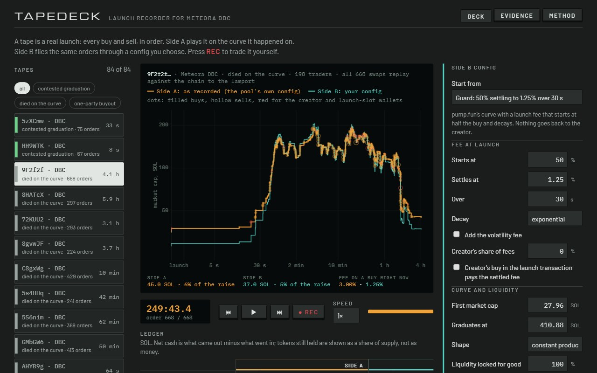
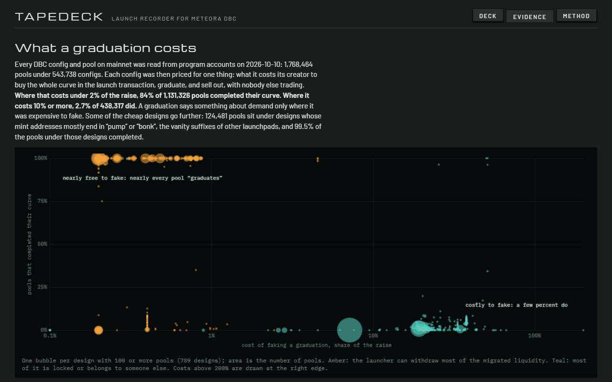

# Tapedeck

Play back any Meteora DBC launch. Fly it again under a different config. Or take the stick and trade it yourself. On an engine that is checked against the chain.

A **tape** is a real launch, order by order: who bought, who sold, when, how much. The deck plays it on two sides.

- **Side A** plays the launch on the curve it happened on.
- **Side B** flies the same orders through any config: one you design (through the SDK's own curve builders) or any config on mainnet, loaded by address. Every buyer spends the same amount at the same moment, every seller sells the same share of what they hold by then. A ledger shows who paid and who collected under each.
- **Any pool.** Paste a DBC pool address and the deck fetches its transactions in your browser, replays every swap against the events the program emitted, tells you whether they match, and puts the pool on the deck with its own config as Side A.
- **REC** hands you a paper wallet. Your orders go onto the tape at the moment you press, and the rest of the launch trades against the price you left behind.
- A config you like leaves as a file for Meteora's [Invent CLI](https://github.com/MeteoraAg/meteora-invent).

Entry for the Meteora track, "Best use of Meteora's Dynamic Bonding Curve", Crypto World's Fair 2026.

**[Open the deck](https://essej72.github.io/tapedeck/)** · **[Pitch](https://essej72.github.io/tapedeck/pitch.html)** · **[Evidence](https://essej72.github.io/tapedeck/#evidence)**



## What it found

<!-- figures:start -->
- **Census:** 1,768,464 pools under 543,738 configs, read from program accounts on 2026-10-10.
- **Where faking a graduation costs under 2% of the raise:** 84% of 1,131,326 pools completed their curve.
- **Where it costs 10% or more:** 2.7% of 438,317 pools did.
- **pump.fun, recorded 2026-10-10 to 2026-10-11:** 78 of 121 graduations that passed the check were one party buying the curve in the launch slot.
- **Engine against chain:** 112,043 real swaps replayed across 348 pools and 50 kinds of config, 0 mismatches.
- **Shelf:** 84 tapes: 24 DBC pools read from the chain and 60 pump.fun launches, picked from 561 that passed the fit check. Of 1,206 pump.fun launches recorded, 584 had under 12 orders and 61 failed the check.
<!-- figures:end -->



The cheapest way onto every "just migrated" feed is for a creator to buy their own curve in the launch transaction. Whether that is expensive or free is decided by the config: the fee at second zero, who the fee goes back to, who owns the liquidity after migration. `src/engine/buyout.ts` prices that round trip for any config. `src/census/` reads every config and pool on mainnet and puts the two side by side. The split is not subtle: where faking is nearly free, nearly everything "graduates".

## Why believe the engine

Prices and fees come from the quote functions of `@meteora-ag/dynamic-bonding-curve-sdk`. Around them, `src/engine/pool.ts` does what the on-chain program does and the SDK leaves to it (`process_swap.rs`, `virtual_pool.rs`, `fee.rs`): refresh the volatility tracker before the quote, apply the result to reserves and fee buckets, split the trading fee between partner and creator, update the tracker after, honour the minimum-fee first swap, complete the curve at the threshold.

Then it is held to the chain:

- `node src/validate.ts <pool>` fetches a pool's whole history, replays every swap from the pool's own events and compares each field of each result with what the program emitted, to the lamport, then the final state with the live account.
- `node src/conformance.ts pick && node src/conformance.ts run` does that for pools spread over every combination of fee mode, fee token, activation type, first-swap setting and quote token in use on mainnet.
- A pump.fun tape goes on the shelf only if a DBC config equal to pump.fun's curve returns the recorded number of tokens on every curve buy.
- The deck does the same check live, in the browser, for any pool you paste. The browser build reads accounts and events from the IDL alone (no Anchor); it is tested against the SDK's Anchor coder on 160 real config accounts and 470 real events.
- `npm test` runs the same checks offline on frozen mainnet data: pool histories of different config kinds, 160 real config accounts, 470 events, three pump.fun tapes.

## Run it

Node 24 or newer. No API keys, no build step for the scripts (Node runs the TypeScript directly).

```bash
npm install
npm test
npm run build
npm run serve
```

The site is static (`docs/`). It works from GitHub Pages or any file host.

## Rebuild the data

Everything comes from public sources: the public mainnet RPC, a second keyless RPC for transaction history, and pump.fun's public trade feed. All reads, nothing signed, nothing sent.

```bash
node src/census/pull.ts pools       # every VirtualPool account (about 15 minutes, paced)
node src/census/pull.ts configs     # every PoolConfig account (about an hour)
node src/census/designs.ts          # designs, outcomes, cost of faking a graduation
node src/census/export.ts           # the trimmed file the site ships

node src/conformance.ts pick        # pools of every kind of config
node src/conformance.ts busy 250    # plus the busiest pools of the last day
node src/conformance.ts run
node src/conformance.ts report

node src/flows/dbc.ts pick 40       # recent busy DBC pools for the shelf
node src/flows/dbc.ts fetch
node src/flows/pumpfun.ts enqueue-listing 10
node src/flows/pumpfun.ts run       # pump.fun tapes, about 18 requests a minute
node src/flows/library.ts           # check, classify and pack the shelf
npm run build
```

## Where things are

| Path | What it is |
|---|---|
| `src/engine/pool.ts` | One virtual pool, advanced swap by swap the way the program does it, on the SDK's math |
| `src/engine/replay.ts` | A session: fly a tape through a config, on the curve and then in the migrated pool; take orders that are not on the tape |
| `src/engine/buyout.ts` | The cost of faking a graduation under a config |
| `src/engine/design.ts` | A design as SDK builder input, as stored config, and as an Invent CLI file |
| `src/engine/bytes.ts`, `src/events.ts`, `src/layout.ts` | Accounts and events read from the IDL alone, for the browser |
| `src/engine/verify.ts` | Replay a pool's history against its own events and report every difference |
| `src/engine/amm.ts` | The migrated pool: exact migration amounts, constant-product trading |
| `src/census/` | The whole-chain census and the design table |
| `src/flows/history.ts`, `chain.ts`, `chaintape.ts`, `dbc.ts` | Pool histories from the chain, verified and turned into tapes |
| `src/flows/pumpfun.ts`, `tapes.ts`, `pack.ts`, `library.ts` | pump.fun tapes: collect, turn trades into orders, check, pack |
| `src/validate.ts`, `src/conformance.ts` | Engine against chain, from the command line and across every kind of config |
| `web/` | The deck, the evidence page, the pitch page |
| `test/` | Offline tests on frozen mainnet data |

## How it uses Meteora

- **SDK math** for every curve trade: `getSwapResultFromExactInput`, `getSwapResultFromPartialInput`, `getSwapResultFromExactOutput`, `getFeeMode`, `getBaseFeeHandler`.
- **SDK builders and validators** for every designed config: `buildCurve`, `buildCurveWithMarketCap`, `buildCurveWithLiquidityWeights`, `getMigrationThresholdPrice`, `getMigrationBaseToken`. A config that plays on Side B is one `create_config` would accept.
- **The IDL** shipped with the SDK for account layouts and event decoding. Offsets are derived, not typed in.
- **Program accounts** read directly: every `PoolConfig` and `VirtualPool` on mainnet.
- **Program events** (`EvtInitializePool`, `EvtSwap2`, `EvtCurveComplete`) as the ground truth for replays.
- **Invent CLI** as the way out: Side B exports a `dbc_config` file, dry run on.

## Limits

- A replay is a stress test, not a forecast. It prices the play on the tape under another config; it does not predict how traders would adapt. Under a 50% launch fee nobody sane buys in the launch slot. REC is the honest way to see how a launch trades differently.
- After migration the pool is modelled as full-range constant product with the config's flat fee. DAMM v2's own fee scheduler and dynamic fee after migration are not applied.
- The trade feed shows trades, not transfers. A wallet that sells tokens it never bought on the tape is merged with the wallet that most plausibly gave them to it. Bundles come out as one trader; an unrelated pair is occasionally merged by mistake.
- Completion rates by design are confounded by who uses each design. The claim is narrow: where faking is nearly free, nearly everything completes, and that is not demand.
- The tapes cover days, not seasons. Paper trading has no latency, failed transactions or priority fees.

## Found on the way

<!-- found:start -->
- **A filter in the SDK looks at the wrong field.** `StateService.getPoolConfigsByOwner(owner)` ("Fetch all pool configs owned by a wallet") filters `PoolConfig` accounts at byte offset 72. That is `leftover_receiver`; `fee_claimer` is at offset 40. On 2026-10-10, 200,278 of 543,738 configs on mainnet (37%) had a fee claimer different from their leftover receiver, and the call does not return those for their fee claimer. Reproduced on mainnet: fee claimer `7AdYv1gs9xhmg87Xyh84ryHrfht4khVvBLSbDqkMTwrm` owns three configs and the call returns none; called with their leftover receiver it returns them. The fix is one number. (SDK 1.5.13.)
- **Slot-based fee schedules run faster than the Invent config says.** Its comments size them at 0.4 s a slot. Block times sampled 100,000 slots apart on 2026-10-10 give 0.219 s a slot, so a schedule written as "60 seconds" in slots lasts about 33. Designs made here count in seconds (timestamp activation).
- **The SDK (1.5.12 and later) no longer builds rate-limiter configs**, so the deck does not offer them for new designs. Configs that already use one still load and play: 45 rate-limiter pools (801 swaps) are in the conformance run, without a mismatch.
<!-- found:end -->

## Credits

Built with Claude Code during the hackathon window. MIT licence.
